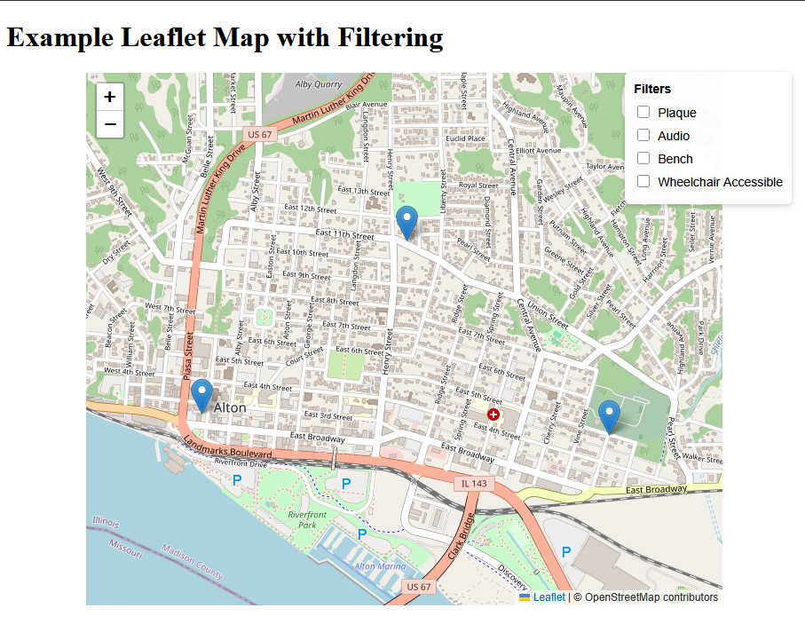

# leaflet-filter-example

This project demonstrates how to display a leaflet map with checkbox filters associated with each location.

You can use this as is by simply editing the data.csv file in the project. Any column with "filter:" prefix will be a filterable value. You can add/remove any number of filters by editing the data.

Other changes will require updating the source files:
* "index.html" to add/edit HTML elements on the page
* "styles.css" to add/edit the styling
* "script.js" to change the functionality (loading the data, changing the filtering, etc).

You can host this as a standalone app using github Pages 

